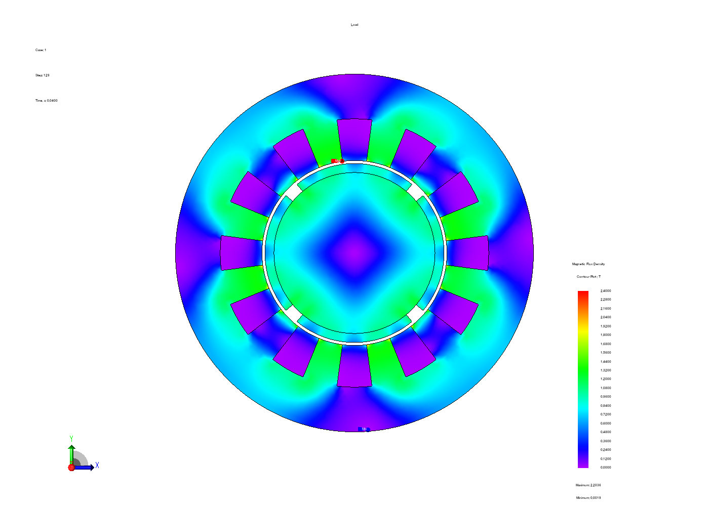
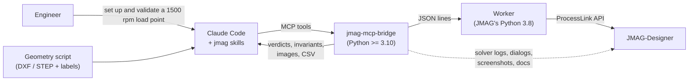
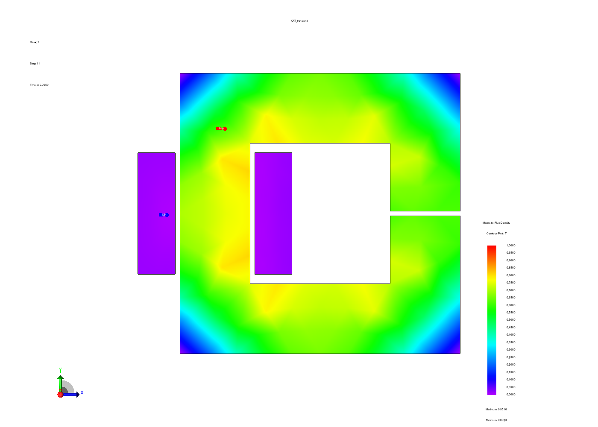
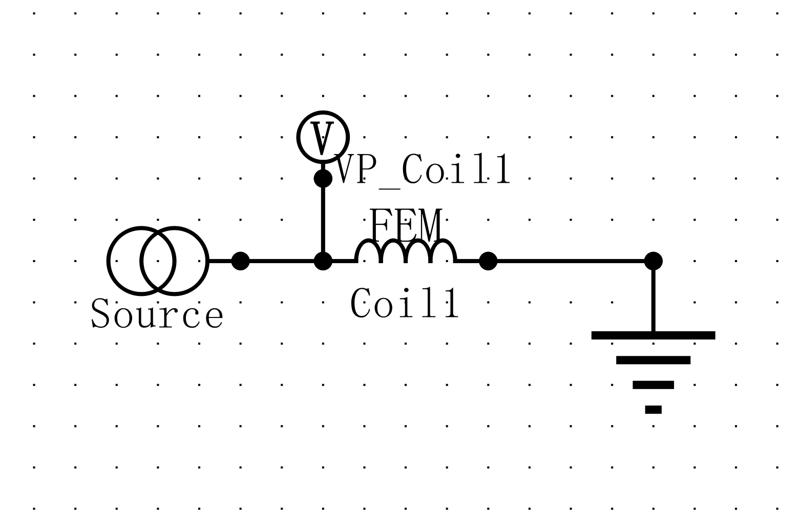

<div align="center">

# jmag-mcp-bridge

**Let an AI agent run JMAG-Designer — and prove the results are physics, not luck.**

An [MCP](https://modelcontextprotocol.io) server and two [Claude skills](https://docs.claude.com/en/docs/claude-code/skills)
that connect coding agents (Claude Code and other MCP clients) to **JMAG-Designer** electromagnetic FEA,
with engineering feedback at every step.




<sub>12-slot / 4-pole SPM motor, built and solved by an agent through the bridge: geometry from a script,
3-phase FEM coils, slide mesh, 1500 rpm. Mean torque 1.774 Nm vs. 1.777 Nm from flux linkage; power balance within 0.12 %.</sub>

</div>

---

## Why

Commercial FEA tools were built for mouse clicks, not for agents. JMAG in particular:

- **rarely raises errors.** A failed call returns an invalid object, logs a line, and everything built on it silently does nothing.
- **blocks on modal dialogs** (for example "save the project before creating geometry"). A script then hangs forever.
- **changes your settings quietly.** It retimes steps for motion and widens the torque integration region.
- **has a Python API that crashes on modern Python.** It is only ABI-safe on its bundled 3.8.

So an agent can't just "call the API". It needs a bridge that turns every one of these into **explicit, actionable feedback**, plus
the engineering judgement to tell a *normal* result from an *abnormal* one. That is this project.

## What the agent gets



| Area | Tools (all `jmag_*`) |
|---|---|
| Session | `status` `connect` `quit` `dialogs` `screenshot` `cleanup` |
| Project & geometry | `new_project` `open_project` `save_project` `summary` `import_dxf` `import_cad` `list_parts` `rename_parts` `suppress_parts` `model_image` |
| Study setup | `create_study` `duplicate_study` `delete_study` `get_properties` `set_properties` `set_step` `set_equations` `get_equations` |
| Materials | `find_materials` `set_material` (incl. magnet orientation) |
| Excitation & conditions | `add_current` `add_fem_coil` `add_fem_conductor` `add_condition` `list_conditions` `delete_condition` |
| Circuits | `circuit_quick` (calibrated 1-phase and 3-phase layouts) `circuit_add` `circuit_summary` `circuit_image` |
| Mesh | `mesh` `mesh_size` (+ slide-mesh settings through `set_properties`) |
| Run | `check` `run` `run_status` `cancel_run` `report` |
| Results | `list_results` `get_result` (stats, harmonics, periodicity) `export_results` `contour_image` `physics_check` |
| Knowledge | `docs_search` `docs_page` (your installed JMAG manual) `api_lookup` (JMAG Python API) |
| Advanced & meta | `exec_python` (escape hatch) `self_test` `journal` (replayable record) |

Basic simulation work is covered as first-class tools: FEM coils, FEM conductors, stack length, step control, materials, equations, circuits, mesh,
result export. PWM inverters, advanced windings and optimisation are reachable via `jmag_exec_python`.

## The feedback ladder: is it working *normally*?

Every tool returns `{"ok", "result", "error": {"message", "hint"}, "jmag_messages"}`. On top of that, the bridge checks at seven levels, cheapest first:

| # | Level | How | Normal looks like |
|---|---|---|---|
| 1 | **Call** | JMAG message-log diff, `IsValid` on every object, read-back of every value, closest-match names | `ok: true`, read == set |
| 2 | **Setup lint** | `jmag_check(stage="pre")`: materials, stack length, links, sources, ground, coil directions, turns, step resolution, motion speed | `PASS` |
| 3 | **Solver** | report + `Designer.log` + Newton iterations per step (`jcgmntr`), known JMAG messages classified | no errors, only known infos |
| 4 | **Physics invariants** | KVL `v = R·i + dψ/dt` · energy `W = ½Σiψ` · power balance `⟨Σ i dψ/dt⟩ = ⟨T⟩ω` | 1e-7 · <1 % · <1 % |
| 5 | **Engineering** | the skill makes the agent compare with a hand estimate (gap reluctance, `3/2·p·ψ·I_q`, `E = ωψ`) | explainable difference |
| 6 | **Visual** | B contours, circuit diagrams, model/mesh images, screenshots of every JMAG window and dialog | poles, flux paths, wiring |
| 7 | **Toolchain** | `jmag_self_test`: a known-answer test on this machine and licence | 6/6 PASS |

### Verified on JMAG-Designer 23.0

| Model | Check | Result |
|---|---|---|
| C-core inductor, static | L vs. analytic (no fringing 9.42 mH) | 11.00 mH (+17 % 2D fringing) |
| | energy identity | 0.76 % |
| C-core inductor, transient + circuit | ψ/i vs. static L | 1.000005 |
| | KVL residual | 2.7 × 10⁻⁷ |
| 12s/4p SPM, 1500 rpm, 10 A | torque vs. `3/2·p·ψ₁·I` | 1.774 vs. 1.777 Nm (0.2 %) |
| | electromechanical power balance | 0.12 % |
| | steady state (last two periods) | 0.09 % |

<table><tr>
<td></td>
<td></td>
</tr><tr>
<td align="center"><sub>Self-test C-core at peak current (leg ≈ 0.73 T, as L·I/(N·A) predicts)</sub></td>
<td align="center"><sub>Circuit from <code>jmag_circuit_quick</code>, wiring proven by the KVL check</sub></td>
</tr></table>

## Quick start

**Requirements:** Windows, a licensed JMAG-Designer 23.x, Python ≥ 3.10, and Claude Code (or any MCP client).

```powershell
git clone https://github.com/<you>/jmag-mcp-bridge
cd jmag-mcp-bridge
.\scripts\install.ps1                      # venv + package, registers MCP server "jmag", installs the skills
# JMAG somewhere unusual?  .\scripts\install.ps1 -JmagHome "E:\JMAG-Designer23.1"
```

Restart Claude Code and ask:

> *Run the JMAG self-test.*

then something real:

> *Here is my motor geometry script. Build a Transient2D load point at 1500 rpm, 10 A peak, 50 mm stack, find the max-torque current angle and prove the torque is right.*

<details>
<summary>Manual setup / other MCP clients</summary>

```powershell
python -m venv .venv
.venv\Scripts\pip install -e .
claude mcp add jmag --scope user -- "$PWD\.venv\Scripts\python.exe" -m jmag_bridge
```

Any MCP client can run the server with `<venv python> -m jmag_bridge` (stdio). Copy `.claude/skills/*` to
`%USERPROFILE%\.claude\skills\` to use the skills outside this repo.

| Env var | Purpose |
|---|---|
| `JMAG_HOME` | JMAG installation folder (auto-detected under `C:`/`D:`/`E:` `\Program Files\JMAG-Designer*`) |
| `JMAG_PYTHON` | override JMAG's bundled `python3.8\python.exe` |
| `JMAG_BRIDGE_HOME` | state, logs, journal, docs index (default `%LOCALAPPDATA%\jmag-mcp-bridge`) |

</details>

## Geometry stays outside JMAG

The bridge deliberately doesn't automate JMAG's Geometry Editor. Draw parametric geometry in a script you can review, version and
test, and export:

- **2D →** DXF. Use the bundled zero-dependency writer `jmag_bridge.dxf.Dxf` (lines, arcs, circles, annular sectors).
- **3D →** STEP from CadQuery, build123d, gmsh/OCC, FreeCAD, … with named solids.
- **Labels JSON →** one inside-point per part, plus the winding layout and magnet polarity. The agent names parts and builds coils
  deterministically from it.

`examples/spm_motor/make_geometry.py` is a complete parametric SPM motor, and `examples/spm_motor/run_mcp.py` drives the whole study
through the public MCP tools. The `jmag-geometry` skill teaches the agent the import rules: closed loops, shared edges, inside points,
and that the air-gap region must be suppressed for rotating machines.

## Skills

| Skill | Teaches the agent |
|---|---|
| `jmag-simulation` | the build → check → run → verify loop, how to read every finding code, JMAG's verified quirks, property names, recipes (inductor, circuit coil, SPM/IPM motor, 3D, sweeps) |
| `jmag-geometry` | writing DXF/STEP + labels scripts that import cleanly |

In a quick A/B test on a realistic troubleshooting prompt ("IPM run aborted with negative element volume, torque −0.3 Nm"), the agent
**without** the skills invented non-existent tools and missed the cause. **With** them, it found both real causes: the air-gap part
blocking the slide mesh, and JMAG's 1 mm default stack length (0.3 Nm × 120). It then used the real tools in the right order and
proposed numerical proof.

## Hard-won JMAG facts (built into the bridge)

<details>
<summary>Things we measured while building this. Each one cost a hang, a crash or a wrong number.</summary>

- `PyJmag.dll` is only safe under CPython 3.8; on 3.11 every void call is an access violation → the worker runs on JMAG's own Python.
- Errors are logged, not raised, even with `SetUseExceptions(True)`. Probing (`GetCondition("x")`, `GetLink()`, `GetValue` on Integer properties) logs errors too.
- Attaching to a dead PID "works"; then every call returns `None`.
- `designer.exe` and PyJmag print to stdout, and a child Designer inherits pipes → protocol isolation and a magic line prefix.
- Geometry Editor needs a saved project, otherwise a modal dialog blocks forever.
- Static studies accept no circuit (use the `Current` condition). The 2D stack length defaults to 1 mm.
- `GetDataFromName` wants internal keys (`LineCurrent`, `TerminalVoltage`, `FEMCoilFlux`); display names return empty tables.
- Circuit terminal offsets were calibrated from exported circuit images (see `ops.TERMINALS`).
- Rotating machines: slide mesh plus no user part bridging rotor and stator. JMAG may rewrite step control for motion.
- `CancelProcess` blocks from a second connection. The Abort button then "Stop calculation" dialog works, but the solver may keep writing for minutes. Killing the solver *before* answering the dialog crashed Designer.
- A Designer launched inside an agent session dies with the session → launched detached via WMI instead.
- Dead Designers leave `modeller.exe` helpers behind → `jmag_cleanup`.

</details>

## Architecture

```
src/jmag_bridge/
├── server.py          MCP tools, run jobs, post-processing        (Python ≥ 3.10)
├── worker_client.py   worker process management, framed JSON protocol
├── worker/
│   ├── jmag_worker.py stdio isolation + request loop              (JMAG's Python 3.8)
│   └── ops.py         every JMAG operation: validate · act · read back · diff messages
├── health.py          pre/post rules, waveform stats, physics invariants (pure, unit-tested)
├── solver_monitor.py  progress/convergence from solver files, safe solver termination
├── winui.py, ps/      dialogs (UI Automation), window screenshots
├── launcher.py        detached JMAG start, running-instance discovery
├── docs_index.py      search the installed JMAG manual + Python API (nothing redistributed)
├── selftest.py        known-answer test
├── replay.py          journal → replay script
└── dxf.py             dependency-free DXF writer
```

Solves run in a separate *runner* worker attached to the same JMAG, so progress, ETA, convergence and cancel stay available
during hour-long runs. See [CLAUDE.md](CLAUDE.md) for contributor notes.

## Development

```powershell
.venv\Scripts\pip install -e ".[dev]"
.venv\Scripts\python -m pytest          # 25 offline tests: health rules, invariants, DXF, solver logs, worker protocol
```

Live tests against a real JMAG are in `tests/live/` (see its README) and `examples/spm_motor/run_mcp.py`.

## Scope and limitations

- Windows only, which is where JMAG-Designer's Python API and the UI-Automation helpers run. Developed and verified on **JMAG-Designer 23.0**; other versions likely need small adjustments (`jmag_self_test` tells you).
- First-class: 2D static/transient studies, circuits, FEM coils/conductors, PM motors, 3D STEP import and static studies.
  Through `jmag_exec_python`: PWM, advanced windings, design-table sweeps, optimisation, iron-loss and thermal studies.
- The IPM recipe in the skill is guidance, not yet a verified end-to-end example.
- JMAG is commercial software. This project contains none of its code or documentation. The documentation tools index
  *your* installation at run time.
- Not affiliated with JSOL Corporation. JMAG is a trademark of JSOL Corporation.

## Acknowledgements

Inspired by [javitc20010326/jmag-designer-agentic-toolkit](https://github.com/javitc20010326/jmag-designer-agentic-toolkit), an early
COM/script-generation take on the same idea for JMAG 18.1. This project re-builds the approach around JMAG 23's ProcessLink API,
validated feedback and physics checks.

## License

MIT, see [LICENSE](LICENSE).
