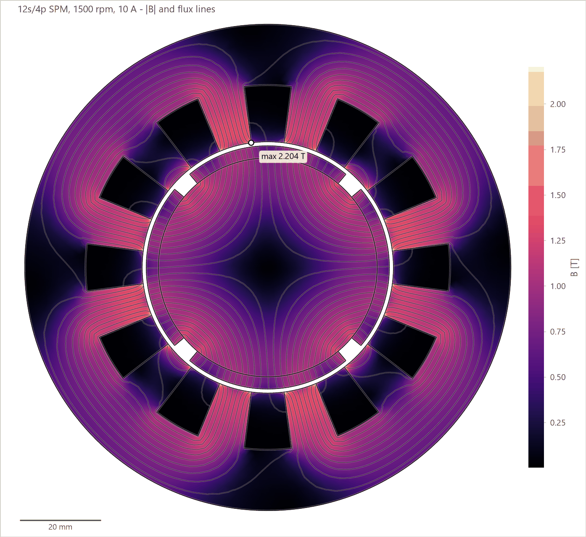
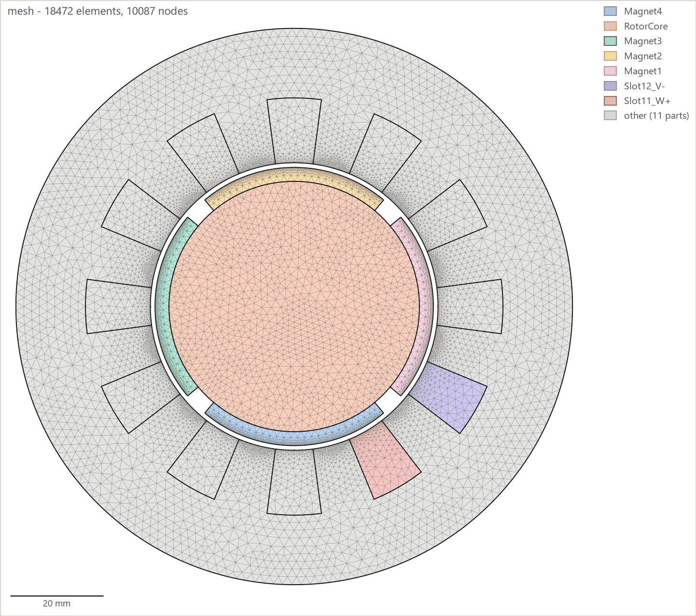
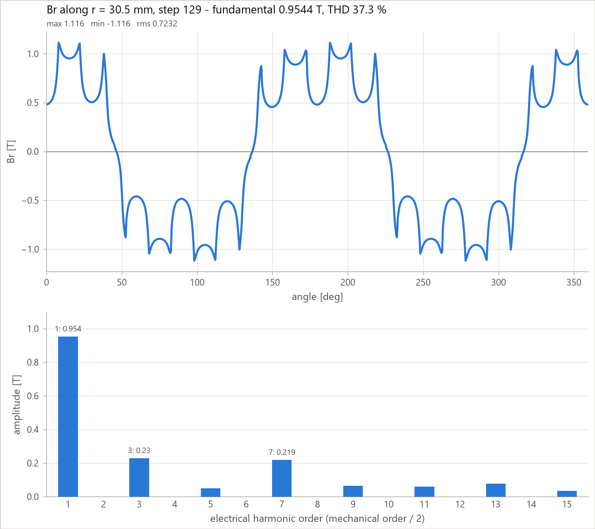
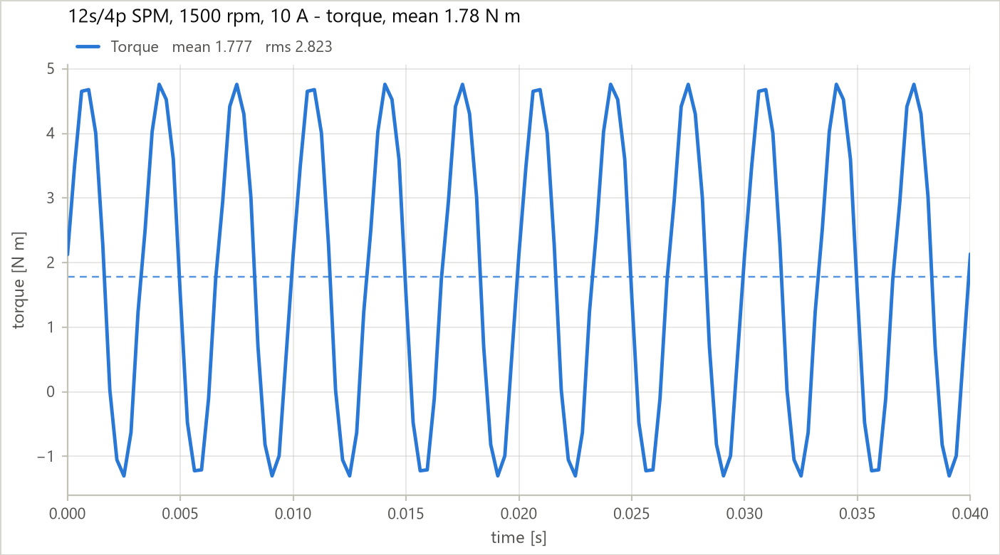
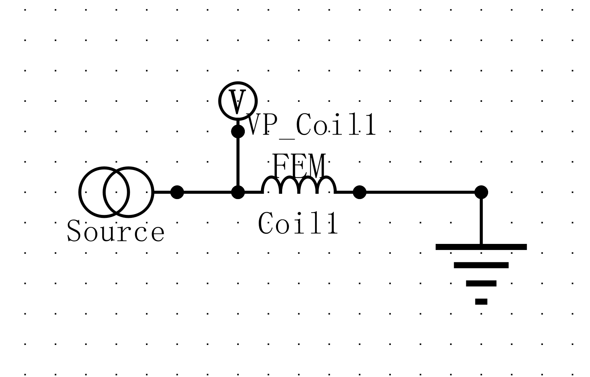
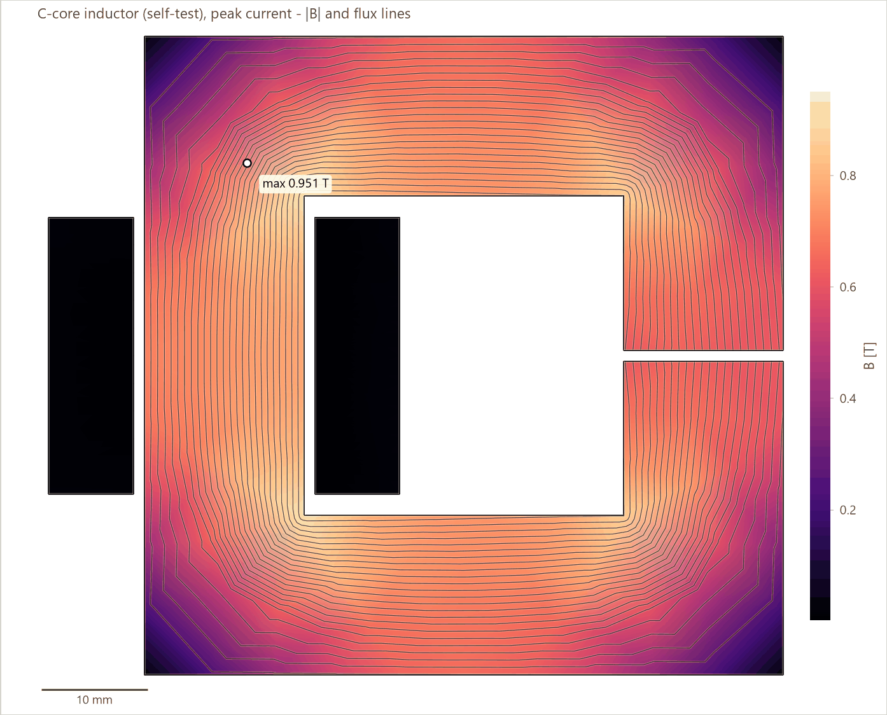

<!-- mcp-name: io.github.Zwl20085/jmag-agent-suite -->
<div align="center">

# JMAG Agent Suite

**Build, solve, verify and *see* JMAG-Designer FEA from an AI agent, with proof that the result is physics, not luck.**

English | [简体中文](README.zh-CN.md)

[](https://github.com/Zwl20085/jmag-agent-suite/actions/workflows/tests.yml)


</div>

<table><tr>
<td width="62%"><br>
<sub>12s/4p SPM at 1500 rpm, 10 A: |B| with flux lines, air hidden, drawn by the bridge from JMAG's result file. Max 2.204 T at a stator tooth tip, identical to JMAG's own contour.</sub></td>
<td>

**What you get**

- **79 MCP tools** drive JMAG-Designer: import, studies, circuits, mesh, runs, results.
- **Every value read back**, every call checked against JMAG's message log.
- **Physics checks** (KVL, energy, power balance) and a known-answer self-test.
- **Fields drawn outside JMAG**: mesh, \|B\|, flux lines and air-gap harmonics as data and clean plots.
- **10 skills** teach the agent how a machine designer judges a result.

</td>
</tr></table>

## What you can ask

> *Here is my motor geometry script. Build a Transient2D load point at 1500 rpm, 10 A peak, 50 mm stack, and prove the torque is right.*

> *Plot the flux density with flux lines, hide the air, and give me the air-gap Br harmonics.*

> *Run cogging torque and back-EMF on this 12-slot / 10-pole design and compare the EMF constant with a hand estimate.*

> *The run aborted with a negative element volume and the torque is -0.3 Nm. What is wrong?*

Every tool answers with `{"ok", "result", "error": {"message", "hint"}, "jmag_messages", "seconds"}`.
`ok` says the tool ran; physics checks say whether the physics held in `result.passed` / `result.verdict`,
and results not yet checked carry `result.unverified`.
The hint is the next action to take.

## See the field, outside JMAG

JMAG's contour export is a screenshot of its GUI.
The bridge reads the study's result file and mesh directly, so the field becomes data you can plot, probe and compare.

| Tool | Does |
|---|---|
| `jmag_field_data` | Field of one step as JSON (nodes, triangles, parts, B / Bx / By / J, nodal Az, JMAG's ids) plus per-part max / min / mean. About 0.5 s. |
| `jmag_field_plot` | The bridge's own plot: \|B\| with flux lines and part outlines, or the mesh. `hide_air`, `parts`, shared colour scales. |
| `jmag_field_probe` | Values along a circle or segment: air-gap Br / Bt with harmonics in electrical orders and THD. |

Plot and probe re-run on a saved JSON with `data_path=`, no JMAG needed.
The max |B| the bridge reports is identical, to all digits, to JMAG's own contour maximum.

<table><tr>
<td width="33%"></td>
<td width="33%"></td>
<td width="33%"></td>
</tr><tr>
<td align="center"><sub>Mesh by part: 28 147 elements, 14 901 nodes, JMAG's ids kept.</sub></td>
<td align="center"><sub>Air-gap Br at r = 30.5 mm: fundamental 0.954 T, THD 37 % (3rd 0.23 T, 7th 0.22 T).</sub></td>
<td align="center"><sub>Torque: mean 1.774 Nm vs 1.777 Nm from flux linkage (0.2 %).</sub></td>
</tr></table>

## Install

Needs Windows, your own licensed JMAG-Designer 23.x, Python 3.10+ and Claude Code (or any MCP client).

```powershell
git clone https://github.com/Zwl20085/jmag-agent-suite
cd jmag-agent-suite
.\scripts\install.ps1          # venv + package, registers MCP server "jmag", installs the 10 skills
```

Restart Claude Code and ask: *run the JMAG self-test*. Six known-answer checks prove the toolchain and licence.
Next: [quickstart](docs/quickstart.md) · [troubleshooting](docs/install-troubleshooting.md) · [other clients](docs/other-clients.md).

<details>
<summary>Doctor, update, installer options, plugin, manual setup, environment variables</summary>

**If nothing shows up:** run `.venv\Scripts\python -m jmag_bridge --doctor`. Each check is PASS, WARN or FAIL with a
`fix:` line. A server that fails to start leaves `server-startup.log` in `%LOCALAPPDATA%\jmag-agent-suite`.

**Update / uninstall:** `git pull; .\scripts\install.ps1` updates. `.\scripts\install.ps1 -Uninstall` removes the MCP
registration and the skills (keeps `.venv`).

**Installer options:** `-JmagHome <folder>`, `-Python <python.exe>`, `-Scope user|project|local`, `-NoMcp`,
`-NoSkills`, `-Uninstall`.

**Other MCP clients** (Cursor, Codex, Claude Desktop, VS Code): see [docs/other-clients.md](docs/other-clients.md).
They do not load skills, so have the agent call `jmag_guide` first.

Plugin (needs [uv](https://docs.astral.sh/uv/)):

```
/plugin marketplace add Zwl20085/jmag-agent-suite
/plugin install jmag@jmag-agent-suite
```

Manual:

```powershell
python -m venv .venv
.venv\Scripts\pip install -e ".[plots]"
claude mcp add jmag --scope user -- "$PWD\.venv\Scripts\python.exe" -m jmag_bridge
```

Any MCP client can run `<venv python> -m jmag_bridge` (stdio). Copy `.claude/skills/*` to
`%USERPROFILE%\.claude\skills\` to use the skills outside this repo.

| Env var | Purpose |
|---|---|
| `JMAG_HOME` | JMAG installation folder (auto-detected under `C:`/`D:`/`E:` `\Program Files\JMAG-Designer*`) |
| `JMAG_PYTHON` | override JMAG's bundled `python3.8\python.exe` |
| `JMAG_BRIDGE_HOME` | state, logs, journal, docs index (default `%LOCALAPPDATA%\jmag-agent-suite`; an older `jmag-mcp-bridge` folder is reused if present) |

Nothing from JSOL is redistributed. The documentation tools index your own installation at run time.

</details>

## How trust works

The bridge checks at seven levels, cheapest first. The agent climbs the ladder and reports where it stopped.

| # | Level | How | Normal looks like |
|---|---|---|---|
| 1 | **Call** | message-log diff, `IsValid` on every object, read-back of every value, closest-match names | `ok: true`, read == set |
| 2 | **Setup lint** | `jmag_check(stage="pre")`: materials, stack length, links, sources, ground, coil directions, turns, step resolution, motion speed | `PASS` |
| 3 | **Solver** | report, `Designer.log`, Newton iterations per step, known JMAG messages classified | no errors, only known infos |
| 4 | **Physics invariants** | KVL `v = R·i + dψ/dt` · energy `W = ½Σiψ` · power balance `⟨Σ i dψ/dt⟩ = ⟨T⟩ω` | KVL < 1e-3 · energy < 5 % · power balance < 5 % |
| 5 | **Engineering** | `jmag_estimate` hand calculations (gap B, kw, Kt, Ld/Lq, L of a gapped core, step plan) with an expected tolerance | FEA inside the tolerance, difference explained |
| 6 | **Visual** | B contours, circuit diagrams, model/mesh images, screenshots of every JMAG window and dialog | poles, flux paths, wiring |
| 7 | **Toolchain** | `jmag_self_test`: a known-answer test on this machine and licence | 6/6 PASS |

<table><tr>
<td width="50%"></td>
<td width="50%"></td>
</tr><tr>
<td align="center"><sub>Circuit from <code>jmag_circuit_quick</code>, wiring proven by the KVL check.</sub></td>
<td align="center"><sub>Self-test C-core at peak current: leg about 0.73 T, as L·I/(N·A) predicts.</sub></td>
</tr></table>

## Verified on JMAG-Designer 23.0

| Model | Check | Result |
|---|---|---|
| C-core inductor, transient + circuit | ψ/i vs. static L · KVL residual | 1.000005 · 2.7 × 10⁻⁷ |
| 12s/4p SPM, 1500 rpm, 10 A | torque vs. `3/2·p·ψ₁·I` | 1.774 vs. 1.777 Nm (0.2 %) |
| | electromechanical power balance | 0.12 % |
| | max \|B\|, bridge vs. JMAG contour (steps 40, 129) | 2.204 T, identical to all digits |
| | J in a coil side vs. N·I / area | 1.4368 × 10⁶ A/m², matches the export |
| 12s/4p SPM, `jmag_experiment` | back-EMF at 1500 rpm | 13.0 V rms per phase, 120° apart, `E = ωψ` consistent |
| | cogging torque | 6.06 Nm peak-to-peak, order 12 per revolution (= LCM(12, 4)) |
| | Ld / Lq from three static solves | 0.367 / 0.366 mH (equal, as an SPM should be) |
| 12s/4p SPM, `jmag_loss_study` | iron loss from the transient | hysteresis 1.998 W + eddy 2.047 W = 4.045 W |
| 12s/4p SPM, `jmag_run_cases` | design table, 10 A and 5 A | 1.804 / 0.910 Nm, ratio 0.504 |
| Linear magnet, `jmag_create_material` | Br 1.2 T, µr 1.05 at 20 °C; at 120 °C with -0.0012 1/K | Br 1.056 T at 120 °C, both read back |

<details>
<summary>Coverage by device and step</summary>

**Verified** = run end-to-end on JMAG-Designer 23.0 with a numerical check. **Tool** = implemented against the
documented API, not yet run on a licence. **Recipe** = the skill walks the agent through it with existing tools.
**Script** = reachable through `jmag_exec_python` with the API-lookup tools.

| Step | SPM | IPM / SynRM | Induction | Transformer / inductor | Actuator / WPT |
|---|---|---|---|---|---|
| Geometry (DXF/STEP + labels) | Verified | Recipe | Recipe | Verified (2D DXF, 3D STEP) | Recipe |
| Winding layout and FEM coils | Verified | Verified | Recipe | Verified (2D inductor) | Verified |
| Static study, 2D (L, force, flux) | Verified (incl. cogging mesh convergence) | Recipe | Recipe | Verified (inductor) | Recipe |
| Static study, 3D (STEP, symmetry / periodic sector, nodal torque, nonlinear B-H) | Verified (axial-flux PM; radial SPM with end windings) | Recipe | Recipe | Verified (transformer L matrix) | Recipe |
| Transient with circuit and motion | Verified | Recipe | Recipe | Verified (2D inductor, no motion) | Recipe |
| 3D transient, 3D windings / FEM coils, 3D field export | Script | Script | Script | Script | Script |
| Setup lint, solver monitor, cancel | Verified | Verified | Verified | Verified | Verified |
| Physics invariants (KVL, energy, power balance) | Verified | Verified | Verified | Verified | Verified |
| Cogging, back-EMF, load point, Ld/Lq (`jmag_experiment`) | Verified | Recipe | Recipe | Recipe | Recipe |
| Magnets: linear Br/µr at temperature | Verified | Verified | n/a | n/a | Verified |
| Magnets: nonlinear B-H table | Tool | Tool | n/a | n/a | Tool |
| Demagnetisation analysis | Script | Script | n/a | n/a | Script |
| Field export and plots (2D) | Verified | Tool | Tool | Tool | Tool |
| Iron-loss study and loss tables | Verified | Tool | Tool | Tool | Tool |
| Efficiency map | Tool | Tool | Script | n/a | n/a |
| JMAG case report, table exporters | Verified | Verified | Verified | Verified | Verified |
| Design table, case sweeps | Verified | Verified | Verified | Verified | Verified |
| Optimisation table | Tool | Tool | Tool | Tool | Tool |
| Plots, comparison, report | Verified | Verified | Verified | Verified | Verified |
| Thermal | Script | Script | Script | Script | Script |
| Force / NVH export | Script | Script | Script | n/a | Script |

The verified column is the [12-slot / 4-pole SPM example](examples/spm_motor) and the self-test C-core.
"Verified" on another device family means the step does not depend on the device.
3D Static was verified on two linear transformers (L within 0.9 % of independent FE), a 12-slot / 10-pole axial-flux
PM machine (linear and deep-saturation nonlinear, full model and periodic sector: psi 0.2-0.6 %, load torque 0.3-1.0 %)
and a radial SPM with straight end windings (psi 0.1 %, load torque 0.2-0.6 %); see the
[3D workflow](.claude/skills/jmag-simulation/references/static-3d-basics.md) (also [rotating machines](.claude/skills/jmag-simulation/references/static-3d-rotating.md), [nonlinear steel](.claude/skills/jmag-simulation/references/static-3d-nonlinear.md)). Nothing 3D beyond Static has been run.

</details>

## Materials and magnets

`jmag_create_material` makes a steel (B-H table, iron-loss constants) or a magnet (linear Br/µr with a temperature
coefficient, or a nonlinear demagnetisation curve). Values are validated before they reach JMAG and read back after.
Temperature-dependent magnet properties are how a thermal operating point enters a magnetostatic or transient study
today. The bridge has no thermal solver workflow.

## Tools by task

<details>
<summary>79 MCP tools, all prefixed <code>jmag_</code></summary>

| Task | Tools |
|---|---|
| Session | `status` `connect` `capabilities` `dialogs` `screenshot` `cleanup` `quit` `doctor` (install diagnostics) |
| Project and geometry | `new_project` `open_project` `save_project` `summary` `inventory` `dxf_inspect` `import_dxf` `import_cad` `list_parts` `rename_parts` `suppress_parts` `model_image` |
| Design helpers (no JMAG needed) | `estimate` `units` `winding_plan` |
| Study setup | `create_study` `duplicate_study` `delete_study` `get_properties` `set_properties` `set_step` `set_equations` `get_equations` |
| Materials | `find_materials` `create_material` `set_material` |
| Excitation and conditions | `add_current` `add_fem_coil` `add_fem_conductor` `winding` `add_condition` `list_conditions` `delete_condition` |
| Circuits | `circuit_quick` `circuit_add` `circuit_summary` `circuit_image` |
| Mesh | `mesh` `mesh_size` |
| Run | `check` `run` `run_status` `cancel_run` `solver_report` |
| Standard tests | `experiment` (cogging, back-EMF, load point, static inductance) |
| Losses and efficiency | `loss_study` `efficiency_map` |
| Parametric and optimisation | `case_table` `run_cases` `optimization_table` |
| Results | `list_results` `get_result` `export_results` `export_table` `case_report` `contour_image` `physics_check` `compare` `plot` `make_report` |
| Fields (2D) | `field_data` `field_plot` `field_probe` |
| Knowledge | `docs_search` `docs_page` (your installed JMAG manual) `api_lookup` (JMAG Python API) |
| Escape hatch and meta | `exec_python` `self_test` `journal` `star_repo` `guide` (the skills, for clients without them) |

Each docstring says whether its JMAG calls are **verified** on 23.0 or **unverified**.
`.claude/skills/jmag/references/tool-map.md` lists every tool in one line.

</details>

## Skills

A router plus nine specialists. Each loads its references only when needed.

| Skill | Teaches the agent |
|---|---|
| `jmag` | where to start: which skill, the safety rules, the tool map |
| `jmag-simulation` | the build, check, run, verify loop; the feedback ladder; JMAG's verified quirks and property names |
| `jmag-geometry` | DXF/STEP + labels scripts that import cleanly; templates for SPM, IPM, induction, SynRM, inductor, solenoid |
| `jmag-machine-design` | analytic sizing and plausibility, slot/pole table, winding factors, turning estimates into checks |
| `jmag-experiments` | cogging, back-EMF, Ld/Lq, load point, torque-speed, locked rotor, open/short circuit, force-stroke, coupling |
| `jmag-losses-efficiency` | iron/copper/magnet loss, loss studies, efficiency maps, what to do about thermal |
| `jmag-parametric-optimisation` | design tables, case runs, DOE, geometry regeneration, optimisation table, Pareto reporting |
| `jmag-postprocess` | result keys, steady-state windows, FFT and ripple, field plots, comparisons, the report checklist |
| `jmag-scripting` | safe `jmag_exec_python` patterns on the Python 3.8 worker, API lookup, promoting a snippet to a tool |
| `jmag-troubleshooting` | symptom to tool to fix: hangs, dialogs, crashes, non-convergence, wrong torque, empty tables |

In an A/B test on a troubleshooting prompt, the agent without skills invented tools and missed the cause.
With them it found both real causes and proposed numerical proof.
A test fails the build if any document names a tool that does not exist.

## Geometry stays outside JMAG

The bridge does not automate JMAG's Geometry Editor.
Draw parametric geometry in a script you can review and test, and export DXF (2D, bundled writer `jmag_bridge.dxf.Dxf`) or STEP (3D) plus a labels JSON with one inside-point per part.
For a DXF you did not write, `jmag_dxf_inspect` lists the regions the import will create (area, inside point, layer), guesses their roles with a confidence and drafts the labels JSON, without JMAG.
[`examples/spm_motor`](examples/spm_motor) is a complete parametric SPM motor, driven end to end through the MCP tools.

## Architecture

<details>
<summary>Process layout</summary>

```
MCP client --stdio--> server.py (Python >= 3.10)       tools, run jobs, orchestration (experiments, cases)
                        |-- worker "main"   --pipes--> worker/ops.py        every JMAG op: validate, act, read back, diff messages
                        |-- worker "runner" (per solve)                    (both on JMAG's own Python 3.8, ProcessLink API)
                        |-- health.py        pre/post rules, physics invariants   (pure, unit-tested)
                        |-- estimate.py winding.py units.py                 analytic layer (pure)
                        |-- dxf.py cad3d.py                                 DXF writer, STEP product/solid name check (pure)
                        |-- fielddata.py                                    field export: mesh, parts, per-part stats, probes (pure)
                        |-- plotting.py reporting.py compare.py             post-processing, field and mesh plots (pure)
                        |-- solver_monitor.py winui.py launcher.py          progress, dialogs, screenshots, detached start
                        `-- docs_index.py                                   search the installed JMAG manual and API
```

Solves run in a separate runner worker attached to the same JMAG, so progress and cancel stay available during long
runs. Contributor notes: [CLAUDE.md](CLAUDE.md), [CONTRIBUTING.md](CONTRIBUTING.md).

</details>

## Docs

- [docs/quickstart.md](docs/quickstart.md): the first ten minutes after installing
- [docs/install-troubleshooting.md](docs/install-troubleshooting.md): one section per install or start-up symptom
- [docs/other-clients.md](docs/other-clients.md): Cursor, Codex, Claude Desktop, VS Code, Windsurf
- [docs/jmag-facts.md](docs/jmag-facts.md): measured JMAG behaviour that cost a hang, a crash or a wrong number
- [CONTRIBUTING.md](CONTRIBUTING.md): how to add a tool or a skill

## Development

```powershell
.venv\Scripts\pip install -e ".[dev,plots]"
.venv\Scripts\python -m pytest          # offline tests: health rules, invariants, estimates, windings, fields, plots, reports, protocol
```

Live tests against a real JMAG are in `tests/live/` and `examples/spm_motor/run_mcp.py`. CI runs the offline suite on
Python 3.10 and 3.12 and the worker protocol on Python 3.8.

## Related work

| Project | Approach |
|---|---|
| [jmag-designer-agentic-toolkit](https://github.com/javitc20010326/jmag-designer-agentic-toolkit) | script generation over COM for JMAG 18.1; the first JMAG agent toolkit and the inspiration for this one |
| [pyaedt-mcp](https://github.com/ansys/pyaedt-mcp), [ansys-aedt-mcp](https://github.com/LaplaceYoung/ansys-aedt-mcp) | MCP wrappers around Ansys AEDT |
| [COMSOL_Multiphysics_MCP](https://github.com/wjc9011/COMSOL_Multiphysics_MCP), [COMSOL-MCP-verifier](https://github.com/yushi-zhou/COMSOL-MCP-verifier) | COMSOL MCP servers; the verifier shares the "prove it" stance |

What is different here: validated feedback on every call, physics invariants, a known-answer self-test, safe cancel,
fields drawn outside the GUI, and skills that encode how an engineer judges a result.

## Scope and limitations

- Windows only. Developed and verified on **JMAG-Designer 23.0**; other versions may need small adjustments
  (`jmag_self_test` and `jmag_capabilities` tell you).
- Field export is 2D planar only. For 3D and axisymmetric models use `jmag_contour_image` (JMAG's own rendering).
- Tools marked unverified in their docstrings (efficiency map, optimisation table, JMAG winding definitions) read back
  every value they set but have not been run on a licence that exercises them. A nonlinear magnet table is read back,
  but its solve is not verified.
- No thermal workflow in the bridge; NVH force export is a JMAG-provided script. The losses skill documents both routes.
- Two JMAG API calls crashed Designer 23.0 in live tests (JMAG winding definitions, field value exports). The bridge
  refuses them unless `force=true`; `jmag_field_data` reads the result file instead.
- JMAG is commercial software. This project contains none of its code or documentation. Not affiliated with JSOL
  Corporation. JMAG is a trademark of JSOL Corporation.

## Support the project

On first use, `jmag_capabilities` and `jmag_self_test` ask once whether you would like to star the repository.
Nothing is starred unless you say yes, and a no is never asked again.

## License

MIT, see [LICENSE](LICENSE).
