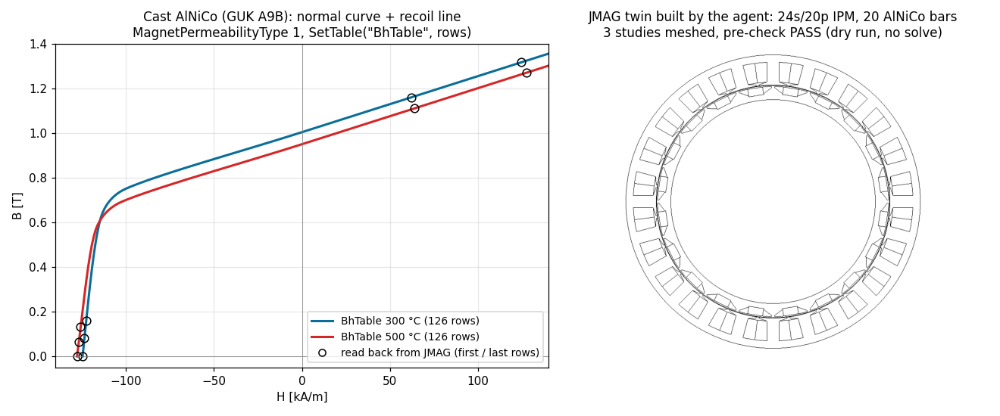

<!-- mcp-name: io.github.Zwl20085/jmag-agent-suite -->
<div align="center">


# JMAG Agent Suite

English | [简体中文](README.zh-CN.md)

**The all-in-one agent toolkit for JMAG-Designer: build, solve, verify, sweep and report electromagnetic designs from your AI agent, with proof that the result is physics, not luck.**

[](https://github.com/Zwl20085/jmag-agent-suite/actions/workflows/tests.yml)


</div>

---

## What you can ask

> *Here is my motor geometry script. Build a Transient2D load point at 1500 rpm, 10 A peak, 50 mm stack, find the max-torque current angle and prove the torque is right.*

> *Run cogging torque and open-circuit back-EMF on this 12-slot / 10-pole design, compare the EMF constant with a hand estimate, and plot the FFT.*

> *Sweep the magnet thickness over 4 cases, solve them all, and write a report with torque, loss and the invariants for each.*

> *Create an iron-loss study from the solved transient study, read the loss per part and check it against the power balance.*

> *The run aborted with a negative element volume and the torque is -0.3 Nm. What is wrong?*

> *Define this AlNiCo grade as a nonlinear magnet from its datasheet B-H curve at 300 °C and 500 °C, assign it to the
> rotor bars with parallel magnetisation, switch on the demagnetisation output at the peak case, and show me what
> JMAG accepted.*

The agent then uses the MCP tools and the skill family below. Every tool answers with
`{"ok", "result", "error": {"message", "hint"}, "jmag_messages"}`, every value set is read back, and the agent is
taught to back each number with a check before claiming success.

One figure per capability:

| Machines: build and solve | Static fields and inductors | Circuits | Magnets: nonlinear B-H |
|---|---|---|---|
|  |  |  |  |
| <sub>12s/4p SPM at 1500 rpm, built and solved by the agent. Torque 1.774 Nm vs 1.777 Nm from flux linkage.</sub> | <sub>Self-test C-core at peak current (leg about 0.73 T, as L·I/(N·A) predicts).</sub> | <sub>Circuit from <code>jmag_circuit_quick</code>, wiring proven by the KVL check.</sub> | <sub>Cast AlNiCo as a tabulated B-H magnet (126 rows set, read back) in a 24s/20p IPM twin; see [Magnets](#magnets-linear-nonlinear-b-h-demagnetisation).</sub> |

## Why this exists

Commercial FEA tools were built for mouse clicks, not for agents. JMAG in particular rarely raises errors (a failed call
returns an invalid object and logs a line), blocks on modal dialogs, quietly rewrites step settings for motion, and
has a Python API that only runs on its bundled Python 3.8. An agent cannot just "call the API". It needs a layer that
turns each of these into explicit, actionable feedback, plus the engineering judgement to tell a normal result from an
abnormal one. That is this project: an [MCP](https://modelcontextprotocol.io) server with 75 tools, a pure-Python
engineering-check library, and ten [Claude skills](https://docs.claude.com/en/docs/claude-code/skills) that teach the
agent how a machine designer works.

## Install

**Requirements:** Windows, your own licensed JMAG-Designer 23.x, Python 3.10 or newer, and Claude Code or any MCP client.
Nothing from JSOL is redistributed; the documentation tools index your own installation at run time.

```powershell
git clone https://github.com/Zwl20085/jmag-agent-suite
cd jmag-agent-suite
.\scripts\install.ps1          # venv + package, registers MCP server "jmag", installs the 10 skills
```

Restart Claude Code and ask: *run the JMAG self-test*. Six known-answer checks tell you the toolchain and licence work.
Next steps: [docs/quickstart.md](docs/quickstart.md).

**If nothing shows up:** run `.venv\Scripts\python -m jmag_bridge --doctor` (the installer already ran it once). Each
check is PASS, WARN or FAIL with a `fix:` line. A server that fails to start leaves its traceback in
`server-startup.log` in the state folder (`%LOCALAPPDATA%\jmag-agent-suite`). Symptom by symptom:
[docs/install-troubleshooting.md](docs/install-troubleshooting.md).

**Update / uninstall:** `git pull; .\scripts\install.ps1` updates; `.\scripts\install.ps1 -Uninstall` removes the MCP
registration and the skills (keeps `.venv`).

**Installer options:** `-JmagHome <folder>`, `-Python <python.exe>`, `-Scope user|project|local`, `-NoMcp` (no Claude
Code needed), `-NoSkills`, `-Uninstall`.

**Other MCP clients (Cursor, Codex, Claude Desktop, VS Code):** config snippets in
[docs/other-clients.md](docs/other-clients.md); have the agent call `jmag_guide` first, since those clients do not load
the skills.

<details>
<summary>As a Claude Code plugin (marketplace), manual setup, other MCP clients, environment variables</summary>

Plugin (needs [uv](https://docs.astral.sh/uv/)):

```
/plugin marketplace add Zwl20085/jmag-agent-suite
/plugin install jmag@jmag-agent-suite
```

Manual:

```powershell
python -m venv .venv
.venv\Scripts\pip install -e ".[plots]"
claude mcp add jmag --scope user -- "$PWD\.venv\Scripts\python.exe" -m jmag_bridge
```

Any MCP client can run the server with `<venv python> -m jmag_bridge` (stdio). Copy `.claude/skills/*` to
`%USERPROFILE%\.claude\skills\` to use the skills outside this repo. JMAG somewhere unusual:
`.\scripts\install.ps1 -JmagHome "E:\JMAG-Designer23.1"`.

| Env var | Purpose |
|---|---|
| `JMAG_HOME` | JMAG installation folder (auto-detected under `C:`/`D:`/`E:` `\Program Files\JMAG-Designer*`) |
| `JMAG_PYTHON` | override JMAG's bundled `python3.8\python.exe` |
| `JMAG_BRIDGE_HOME` | state, logs, journal, docs index (default `%LOCALAPPDATA%\jmag-agent-suite`; an older `jmag-mcp-bridge` folder is reused if present) |

</details>

## Coverage

What an electrical-machine engineer does with JMAG, and how much of it the agent can do today.
**Verified** = run end-to-end on JMAG-Designer 23.0 with a numerical check. **Tool** = implemented against the documented
API but not yet exercised on a real licence. **Recipe** = the skill walks the agent through it with existing tools.
**Script** = reachable through `jmag_exec_python` with the API-lookup tools.

| Step | SPM | IPM / SynRM | Induction | Transformer / inductor | Actuator / WPT |
|---|---|---|---|---|---|
| Geometry (DXF/STEP + labels) | Verified | Recipe | Recipe | Verified | Recipe |
| Winding layout and FEM coils | Verified | Verified | Recipe | Verified | Verified |
| Static study (L, force, flux) | Verified | Recipe | Recipe | Verified | Recipe |
| Transient with circuit and motion | Verified | Recipe | Recipe | Verified | Recipe |
| Setup lint, solver monitor, cancel | Verified | Verified | Verified | Verified | Verified |
| Physics invariants (KVL, energy, power balance) | Verified | Verified | Verified | Verified | Verified |
| Cogging, back-EMF, load point, Ld/Lq (`jmag_experiment`) | Verified | Recipe | Recipe | Recipe | Recipe |
| Iron-loss study and loss tables | Verified | Tool | Tool | Tool | Tool |
| Efficiency map | Tool | Tool | Script | n/a | n/a |
| JMAG case report, table exporters | Verified | Verified | Verified | Verified | Verified |
| Design table, case sweeps | Verified | Verified | Verified | Verified | Verified |
| Optimisation table | Tool | Tool | Tool | Tool | Tool |
| Plots, comparison, report | Verified | Verified | Verified | Verified | Verified |
| Thermal | Script | Script | Script | Script | Script |
| Force / NVH export | Script | Script | Script | n/a | Script |
| Magnets: linear Br / μr | Verified | Verified | n/a | n/a | Recipe |
| Magnets: nonlinear B-H table per temperature | Script | Script | n/a | n/a | Script |
| Irreversible demagnetisation analysis | Script | Script | n/a | n/a | Script |

The verified column is the [12-slot / 4-pole SPM example](examples/spm_motor) and the self-test C-core; the table doubles
as the roadmap. "Verified" entries on other device families mean the step does not depend on the device.

## Magnets: linear, nonlinear B-H, demagnetisation

Permanent magnets are custom materials created through `jmag_exec_python` (the material editor API), then assigned with
`jmag_set_material` and an orientation. The agent reads every value back before it uses the material.

| Model | Material-editor calls (`um = lib.GetUserMaterial(name)`) | When |
|---|---|---|
| Linear (Br, recoil μr) | `SetValue("MagneticPropertyType", 1)`, `SetValue("MagnetPermeabilityType", 6)`, `ResidualMagneticFluxDensity`, `MagnetPermeability` | sintered SmCo / NdFeB above the knee |
| **Nonlinear, reversible B-H table** | `SetValue("MagnetPermeabilityType", 1)`, `SetTable("BhTable", [[H_A_per_m, B_T], ...])`, `RecoilPermeability`; read back with `GetTable("BhTable")`, `GetRows()`, `GetValue(i, j)` | cast AlNiCo, any magnet whose operating point comes from its curve |
| One curve per temperature | one material per case temperature (`MAG_<grade>_<T>C`), the table of that temperature | until the `TemperatureBhTable` TableList layout is documented |
| Demagnetisation analysis | material condition `ReversibleDemag` (0 = irreversible) via `jmag_set_properties(kind="material", name=<part>)`; study outputs `DemagnetizationRatio`, `DemagnetizationRatioDiffUnDemag` | the peak or fault case |

Property names and enum values come from the installed JMAG 23 script reference (`jmag_docs_search`,
`jmag_docs_page`: `MagnetPermeabilityType` 0 Linear, 1 NonLinearReversible, 2 NonLinearReversibleWithTemperature,
3 NonLinearNonReversible, 6 MagnetLinearBr, 8 NonReversible point array); `jmag_get_properties(kind="material",
with_help=True)` lists what the live install offers.

**Worked example: the AlNiCo twin.** A 24-slot / 20-pole IPM with 20 cast AlNiCo bars (GUK A9B, Br 1.08 T,
HcB 120 kA/m), driven unattended through the public tools:

1. the datasheet curve at 300 °C and 500 °C (126 rows each: the normal curve and the recoil line) goes in as `BhTable`
   with `MagnetPermeabilityType` 1, and comes back row for row;
2. each bar gets the material with pattern `Parallel` and its `DirectionAngle` (N outward, S inward);
3. Rated_300C, Peak_500C and NoLoad_1000rpm are built, meshed and pre-checked (`PASS` x 3) in a build-only pass;
4. Peak_500C carries `ReversibleDemag` 0 and the demagnetisation-ratio outputs for the overnight solve.

The material and study property lists the install returned (`ReversibleDemag`, `MagnetTemperatureType`,
`UseMagnetizedMagnet`, `DemagnetizationRatio`, ...) are recorded with the model, so nothing about the setup is guessed.

Not documented yet (the agent reports these rather than approximating): the column layout of the irreversible
point-array tables (`DemagBhTable`, `DemagIrreversibleBhTable`) used by `MagnetPermeabilityType` 8, and a scalar reader
for the demagnetisation-ratio results, which are contour results (inspect them in the GUI or with `jmag_contour_image`).

## How trust works: the feedback ladder

The bridge checks at seven levels, cheapest first. The agent is taught to climb it and to report where it stopped.

| # | Level | How | Normal looks like |
|---|---|---|---|
| 1 | **Call** | message-log diff, `IsValid` on every object, read-back of every value, closest-match names | `ok: true`, read == set |
| 2 | **Setup lint** | `jmag_check(stage="pre")`: materials, stack length, links, sources, ground, coil directions, turns, step resolution, motion speed | `PASS` |
| 3 | **Solver** | report, `Designer.log`, Newton iterations per step, known JMAG messages classified | no errors, only known infos |
| 4 | **Physics invariants** | KVL `v = R·i + dψ/dt` · energy `W = ½Σiψ` · power balance `⟨Σ i dψ/dt⟩ = ⟨T⟩ω` | KVL < 1e-3 · energy < 5 % · power balance < 5 % |
| 5 | **Engineering** | `jmag_estimate` hand calculations (gap B, kw, Kt, Ld/Lq, L of a gapped core, step plan) with an expected tolerance | FEA inside the tolerance, difference explained |
| 6 | **Visual** | B contours, circuit diagrams, model/mesh images, screenshots of every JMAG window and dialog | poles, flux paths, wiring |
| 7 | **Toolchain** | `jmag_self_test`: a known-answer test on this machine and licence | 6/6 PASS |

### Verified on JMAG-Designer 23.0

| Model | Check | Result |
|---|---|---|
| C-core inductor, static | L vs. analytic (no fringing 9.42 mH) | 11.00 mH (+17 % 2D fringing) |
| | energy identity | 0.76 % |
| C-core inductor, transient + circuit | ψ/i vs. static L | 1.000005 |
| | KVL residual | 2.7 × 10⁻⁷ |
| 12s/4p SPM, 1500 rpm, 10 A | torque vs. `3/2·p·ψ₁·I` | 1.774 vs. 1.777 Nm (0.2 %) |
| | electromechanical power balance | 0.12 % |
| | steady state (last two periods) | 0.09 % |
| 12s/4p SPM, `jmag_experiment` | back-EMF at 1500 rpm | 13.0 V rms per phase, phases 120° apart, `E = ωψ` consistent |
| | cogging torque | 6.06 Nm peak-to-peak, dominant order 12 per revolution (= LCM(12, 4)) |
| | Ld / Lq from three static solves | 0.367 / 0.366 mH (equal, as an SPM should be) |
| | load point power balance | 0.9 % |
| 12s/4p SPM, `jmag_loss_study` | iron-loss study from the transient | stator hysteresis 1.998 W + eddy 2.047 W = 4.045 W total |
| 12s/4p SPM, `jmag_run_cases` | design table, 2 cases (10 A, 5 A) | 1.804 / 0.910 Nm, ratio 0.504, per-case results via `case=` |
| 24s/20p IPM, linear Sm2Co17 bars | HairpinFE twin: flux linkage / back-EMF / peak torque | within 0.25 % / 0.2 % / 0.45 % |
| 24s/20p IPM, cast AlNiCo B-H table (build only) | `BhTable` set vs read back; pre-check of 3 studies | 126 / 126 rows identical; 3 × PASS |

## Tools by task

<details open>
<summary>75 MCP tools, all prefixed <code>jmag_</code></summary>

| Task | Tools |
|---|---|
| Session | `status` `connect` `capabilities` `dialogs` `screenshot` `cleanup` `quit` `doctor` (install diagnostics) |
| Project and geometry | `new_project` `open_project` `save_project` `summary` `inventory` `import_dxf` `import_cad` `list_parts` `rename_parts` `suppress_parts` `model_image` |
| Design helpers (no JMAG needed) | `estimate` `units` `winding_plan` |
| Study setup | `create_study` `duplicate_study` `delete_study` `get_properties` `set_properties` `set_step` `set_equations` `get_equations` |
| Materials | `find_materials` `create_material` `set_material` |
| Excitation and conditions | `add_current` `add_fem_coil` `add_fem_conductor` `winding` `add_condition` `list_conditions` `delete_condition` |
| Circuits | `circuit_quick` `circuit_add` `circuit_summary` `circuit_image` |
| Mesh | `mesh` `mesh_size` |
| Run | `check` `run` `run_status` `cancel_run` `solver_report` |
| Standard tests | `experiment` (cogging, back-EMF, load point, static inductance) |
| Losses and efficiency | `loss_study` `efficiency_map` |
| Parametric and optimisation | `case_table` `run_cases` `optimization_table` |
| Results | `list_results` `get_result` `export_results` `export_table` `case_report` `contour_image` `physics_check` `compare` `plot` `make_report` |
| Knowledge | `docs_search` `docs_page` (your installed JMAG manual) `api_lookup` (JMAG Python API) |
| Escape hatch and meta | `exec_python` `self_test` `journal` `star_repo` `guide` (the skills, for clients without them) |

Each tool's docstring states whether its JMAG calls are **verified** on 23.0 or **unverified** (implemented from the API
reference). The skill `jmag/references/tool-map.md` lists every tool in one line.

</details>

## Skills

A router plus nine specialists. Each skill is short and loads its references only when needed.

| Skill | Teaches the agent |
|---|---|
| `jmag` | where to start: which skill, the safety rules, the tool map |
| `jmag-simulation` | the build, check, run, verify loop; the feedback ladder; JMAG's verified quirks and property names |
| `jmag-geometry` | DXF/STEP + labels scripts that import cleanly; templates for SPM, IPM, induction, SynRM, inductor, solenoid |
| `jmag-machine-design` | analytic sizing and plausibility, slot/pole table, winding factors, turning estimates into checks |
| `jmag-experiments` | cogging, back-EMF, Ld/Lq, load point, torque-speed, locked rotor, open/short circuit, force-stroke, coupling |
| `jmag-losses-efficiency` | iron/copper/magnet loss, loss studies, efficiency maps, what to do about thermal |
| `jmag-parametric-optimisation` | design tables, case runs, DOE, geometry regeneration, optimisation table, Pareto reporting |
| `jmag-postprocess` | result keys, steady-state windows, FFT and ripple, plots, comparisons, the report checklist |
| `jmag-scripting` | safe `jmag_exec_python` patterns on the Python 3.8 worker, API lookup, promoting a snippet to a tool |
| `jmag-troubleshooting` | symptom to tool to fix: hangs, dialogs, crashes, non-convergence, wrong torque, empty tables |

In an A/B test on a troubleshooting prompt ("IPM run aborted with negative element volume, torque -0.3 Nm"), the agent
without the skills invented non-existent tools and missed the cause. With them, it found both real causes (the air-gap
part blocking the slide mesh, and JMAG's 1 mm default stack length), used the real tools in the right order and proposed
numerical proof. A test now fails the build if any document names a tool that does not exist.

## Geometry stays outside JMAG

The bridge deliberately does not automate JMAG's Geometry Editor. Draw parametric geometry in a script you can review,
version and test, and export: DXF for 2D (the bundled zero-dependency writer `jmag_bridge.dxf.Dxf`), STEP for 3D
(CadQuery, build123d, gmsh, FreeCAD), plus a labels JSON with one inside-point per part, the winding layout and magnet
polarity. `jmag_winding_plan` produces that winding layout from slot, pole and phase numbers.
`examples/spm_motor/make_geometry.py` is a complete parametric SPM motor and `examples/spm_motor/run_mcp.py` drives
the whole study through the public MCP tools.

## Architecture

```
MCP client --stdio--> server.py (Python >= 3.10)       tools, run jobs, orchestration (experiments, cases)
                        |-- worker "main"   --pipes--> worker/ops.py        every JMAG op: validate, act, read back, diff messages
                        |-- worker "runner" (per solve)                    (both on JMAG's own Python 3.8, ProcessLink API)
                        |-- health.py        pre/post rules, physics invariants   (pure, unit-tested)
                        |-- estimate.py winding.py units.py                 analytic layer (pure)
                        |-- plotting.py reporting.py compare.py             post-processing (pure)
                        |-- solver_monitor.py winui.py launcher.py          progress, dialogs, screenshots, detached start
                        `-- docs_index.py                                   search the installed JMAG manual and API
```

Solves run in a separate runner worker attached to the same JMAG, so progress, convergence and cancel stay available
during hour-long runs. The things JMAG does that cost us a hang, a crash or a wrong number are collected in
[docs/jmag-facts.md](docs/jmag-facts.md); contributor notes are in [CLAUDE.md](CLAUDE.md) and
[CONTRIBUTING.md](CONTRIBUTING.md).

## Docs

- [docs/quickstart.md](docs/quickstart.md): the first ten minutes after installing
- [docs/install-troubleshooting.md](docs/install-troubleshooting.md): one section per install or start-up symptom
- [docs/other-clients.md](docs/other-clients.md): Cursor, Codex, Claude Desktop, VS Code, Windsurf
- [docs/jmag-facts.md](docs/jmag-facts.md): measured JMAG behaviour that cost a hang, a crash or a wrong number
- [CONTRIBUTING.md](CONTRIBUTING.md): how to add a tool or a skill

## Development

```powershell
.venv\Scripts\pip install -e ".[dev,plots]"
.venv\Scripts\python -m pytest          # offline tests: health rules, invariants, estimates, windings, plots, reports, protocol
```

Live tests against a real JMAG are in `tests/live/` and `examples/spm_motor/run_mcp.py`. CI runs the offline suite on
Python 3.10 and 3.12 and the worker protocol on Python 3.8.

## Related work

| Project | Approach |
|---|---|
| [jmag-designer-agentic-toolkit](https://github.com/javitc20010326/jmag-designer-agentic-toolkit) | script generation over COM for JMAG 18.1; the first JMAG agent toolkit and the inspiration for this one |
| [pyaedt-mcp](https://github.com/ansys/pyaedt-mcp), [ansys-aedt-mcp](https://github.com/LaplaceYoung/ansys-aedt-mcp) | MCP wrappers around Ansys AEDT |
| [COMSOL_Multiphysics_MCP](https://github.com/wjc9011/COMSOL_Multiphysics_MCP), [COMSOL-MCP-verifier](https://github.com/yushi-zhou/COMSOL-MCP-verifier) | COMSOL MCP servers; the verifier shares the "prove it" stance |

What is different here: validated feedback on every call, physics invariants, a known-answer self-test, safe cancel, and
skills that encode how an engineer judges a result.

## Scope and limitations

- Windows only, where JMAG-Designer's Python API and the UI-Automation helpers run. Developed and verified on
  **JMAG-Designer 23.0**; other versions likely need small adjustments (`jmag_self_test` and `jmag_capabilities` tell you).
- Tools marked unverified in their docstrings (efficiency map, optimisation table, JMAG winding definitions) were
  implemented from the API reference and read back every value they set, but have not been run on a licence that
  exercises them. Reports from other installations are welcome.
- Thermal study types exist on a full licence (`jmag_capabilities` lists them) but there is no thermal workflow in the
  bridge yet; NVH force export is a JMAG-provided script. The losses skill documents the export route for both.
- Two API calls crashed Designer 23.0 in live tests (JMAG winding definitions, field value exports). The bridge refuses
  them unless `force=true`.
- Magnets: linear and tabulated reversible B-H magnets are built and read back. JMAG's irreversible
  (point-array) magnet model needs a table layout the script reference does not give, and the demagnetisation ratio is a
  contour result with no scalar reader in the bridge.
- JMAG is commercial software. This project contains none of its code or documentation. Not affiliated with JSOL
  Corporation. JMAG is a trademark of JSOL Corporation.

## Support the project

On first use on a machine, `jmag_capabilities` and `jmag_self_test` include a one-time `first_run_note` asking
whether you would like to star the repository on GitHub. It is opt-in: nothing is starred unless you say yes (then
through the GitHub CLI, or the repo page opens in your browser if `gh` is unavailable). Answer no and it is never
asked again; the answer lives under `star_prompt` in `state.json` in the state folder (`JMAG_BRIDGE_HOME`).

## License

MIT, see [LICENSE](LICENSE).
