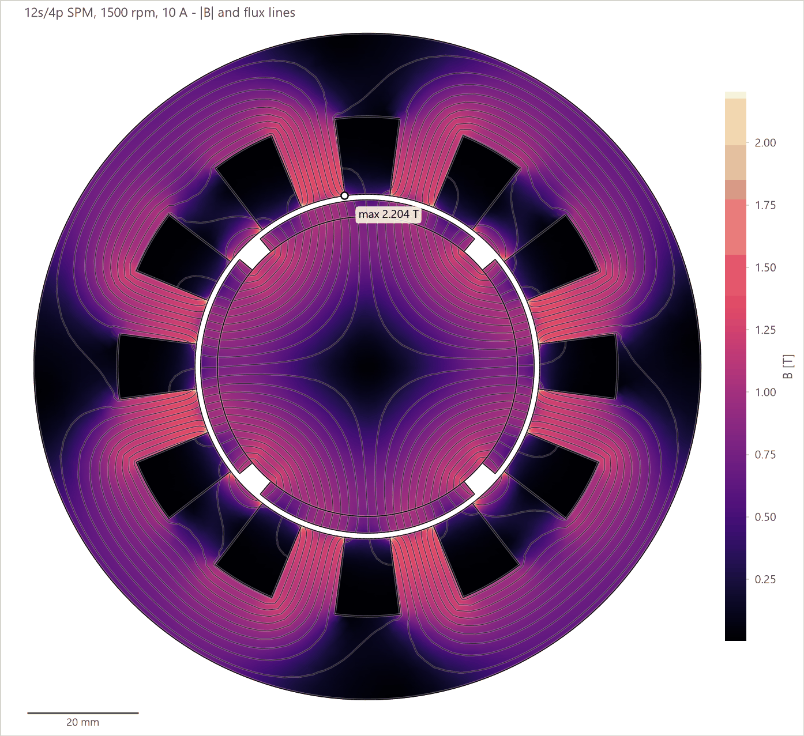
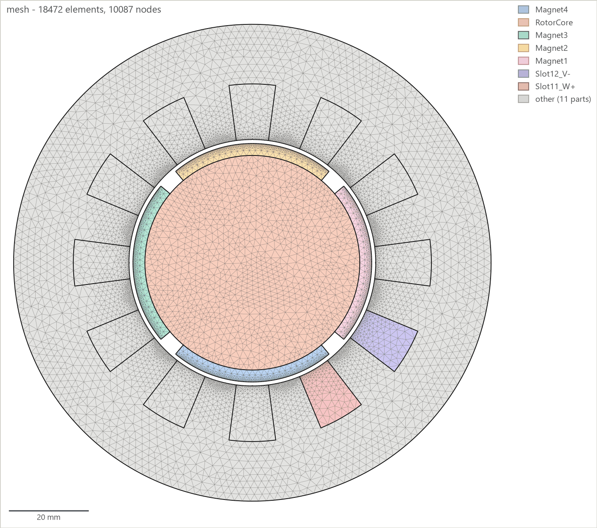
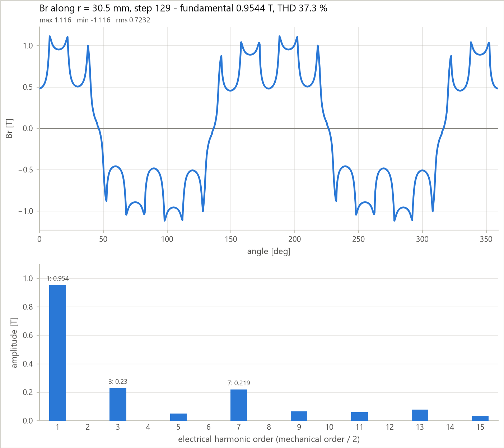
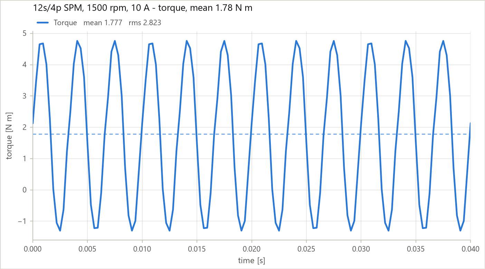
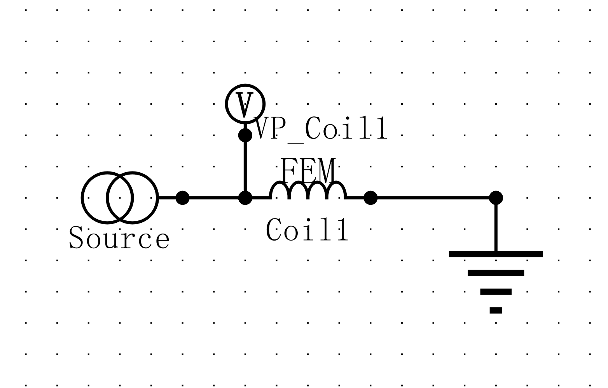
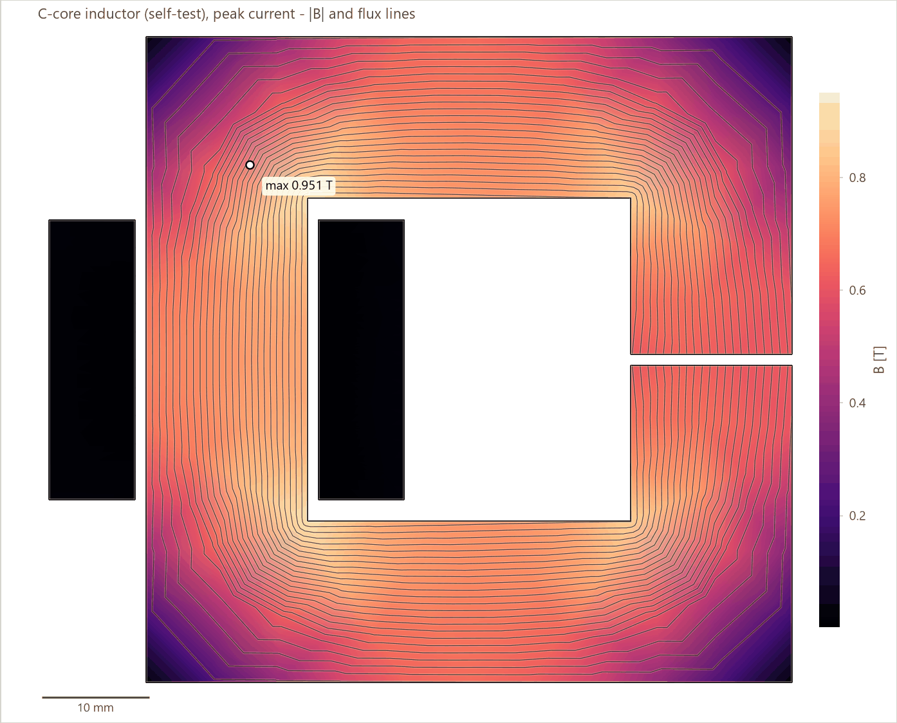

<!-- mcp-name: io.github.Zwl20085/jmag-agent-suite -->
<div align="center">

# JMAG Agent Suite

**让 AI 智能体完成 JMAG-Designer 有限元的建模、求解、验证，并且*看见*场分布；同时证明结果来自物理规律，而不是碰巧。**

[English](README.md) | 简体中文

[](https://github.com/Zwl20085/jmag-agent-suite/actions/workflows/tests.yml)


</div>

<table><tr>
<td width="62%"><br>
<sub>12s/4p SPM，1500 rpm，10 A：|B| 与磁力线，隐藏空气域，由桥接层直接读取 JMAG 结果文件绘制。最大值 2.204 T 位于定子齿尖，与 JMAG 自身云图的最大值完全一致。</sub></td>
<td>

**你能得到什么**

- **78 个 MCP 工具**驱动 JMAG-Designer：导入、研究、电路、网格、求解、结果。
- **每个设置值都回读**，每次调用都对照 JMAG 的消息日志检查。
- **物理不变量**（KVL、能量、功率平衡）和已知答案自检。
- **在 JMAG 之外绘制场图**：网格、\|B\|、磁力线和气隙谐波，既是数据也是清晰的图。
- **10 个技能**教智能体像电机设计师一样判断结果。

</td>
</tr></table>

## 可以这样提问

> *这是我的电机几何脚本。建立一个 Transient2D 工况点：1500 rpm，峰值 10 A，叠厚 50 mm，并证明转矩是对的。*

> *画出带磁力线的磁密分布，隐藏空气，并给出气隙 Br 的谐波。*

> *对这个 12 槽 10 极设计计算齿槽转矩和反电动势，把反电动势常数与手算估值对比。*

> *运行因单元体积为负而中止，转矩是 -0.3 Nm。问题出在哪里？*

每个工具都返回 `{"ok", "result", "error": {"message", "hint"}, "jmag_messages"}`。
其中 hint 就是下一步该做的操作。

## 在 JMAG 之外看场

JMAG 的云图导出只是 GUI 截图。
桥接层直接读取研究的结果文件和网格，场因此变成可以绘图、探测和对比的数据。

| 工具 | 作用 |
|---|---|
| `jmag_field_data` | 把某一步的场导出为 JSON（节点、三角形、部件、B / Bx / By / J、节点 Az、JMAG 原始编号），并给出各部件的最大 / 最小 / 平均值。约 0.5 s。 |
| `jmag_field_plot` | 桥接层自己的绘图：带磁力线和部件轮廓的 \|B\|，或网格。支持 `hide_air`、`parts`、统一色标。 |
| `jmag_field_probe` | 沿圆或线段取值：气隙 Br / Bt，按电角度阶次给出谐波和 THD。 |

绘图和探测都可以用 `data_path=` 对已保存的 JSON 重新运行，无需 JMAG。
桥接层报告的最大 |B| 与 JMAG 自身云图的最大值逐位相同。

<table><tr>
<td width="33%"></td>
<td width="33%"></td>
<td width="33%"></td>
</tr><tr>
<td align="center"><sub>按部件着色的网格：28 147 个单元，14 901 个节点，保留 JMAG 编号。</sub></td>
<td align="center"><sub>r = 30.5 mm 处气隙 Br：基波 0.954 T，THD 37 %（3 次 0.23 T，7 次 0.22 T）。</sub></td>
<td align="center"><sub>转矩：平均 1.774 Nm，由磁链算得 1.777 Nm（0.2 %）。</sub></td>
</tr></table>

## 安装

需要 Windows、自己持有许可证的 JMAG-Designer 23.x、Python 3.10+，以及 Claude Code（或任意 MCP 客户端）。

```powershell
git clone https://github.com/Zwl20085/jmag-agent-suite
cd jmag-agent-suite
.\scripts\install.ps1          # venv + package, registers MCP server "jmag", installs the 10 skills
```

重启 Claude Code 并提问：*run the JMAG self-test*（运行 JMAG 自检）。六项已知答案检查会证明工具链和许可证可用。
下一步：[快速上手](docs/quickstart.md) · [故障排查](docs/install-troubleshooting.md) · [其他客户端](docs/other-clients.md)。

<details>
<summary>诊断、更新、安装选项、插件、手动安装、环境变量</summary>

**如果没有任何反应：** 运行 `.venv\Scripts\python -m jmag_bridge --doctor`。每项检查为 PASS、WARN 或 FAIL，并附一行
`fix:` 提示。服务器启动失败时，会在 `%LOCALAPPDATA%\jmag-agent-suite` 中留下 `server-startup.log`。

**更新 / 卸载：** `git pull; .\scripts\install.ps1` 用于更新。`.\scripts\install.ps1 -Uninstall` 移除 MCP 注册和技能（保留 `.venv`）。

**安装选项：** `-JmagHome <folder>`、`-Python <python.exe>`、`-Scope user|project|local`、`-NoMcp`、
`-NoSkills`、`-Uninstall`。

**其他 MCP 客户端**（Cursor、Codex、Claude Desktop、VS Code）：见 [docs/other-clients.md](docs/other-clients.md)。
这些客户端不加载技能，因此应让智能体先调用 `jmag_guide`。

插件（需要 [uv](https://docs.astral.sh/uv/)）：

```
/plugin marketplace add Zwl20085/jmag-agent-suite
/plugin install jmag@jmag-agent-suite
```

手动安装：

```powershell
python -m venv .venv
.venv\Scripts\pip install -e ".[plots]"
claude mcp add jmag --scope user -- "$PWD\.venv\Scripts\python.exe" -m jmag_bridge
```

任何 MCP 客户端都可以运行 `<venv python> -m jmag_bridge`（stdio）。若要在本仓库之外使用技能，把 `.claude/skills/*` 复制到
`%USERPROFILE%\.claude\skills\`。

| 环境变量 | 用途 |
|---|---|
| `JMAG_HOME` | JMAG 安装文件夹（自动在 `C:`/`D:`/`E:` 的 `\Program Files\JMAG-Designer*` 下查找） |
| `JMAG_PYTHON` | 覆盖 JMAG 自带的 `python3.8\python.exe` |
| `JMAG_BRIDGE_HOME` | 状态、日志、journal、文档索引（默认 `%LOCALAPPDATA%\jmag-agent-suite`；若存在旧的 `jmag-mcp-bridge` 文件夹则继续使用） |

不分发 JSOL 的任何内容。文档类工具在运行时为你自己安装的 JMAG 建立索引。

</details>

## 信任机制

桥接层按七个层级检查，由低成本到高成本。智能体逐级向上检查，并报告停在哪一级。

| # | 层级 | 方法 | 正常表现 |
|---|---|---|---|
| 1 | **调用** | 消息日志差异、对每个对象做 `IsValid`、回读每个值、最接近名称匹配 | `ok: true`，读回值 == 设置值 |
| 2 | **设置检查** | `jmag_check(stage="pre")`：材料、叠厚、链接、激励源、接地、线圈方向、匝数、步长分辨率、运动速度 | `PASS` |
| 3 | **求解器** | 报告、`Designer.log`、每步 Newton 迭代次数、已知 JMAG 消息分类 | 无错误，只有已知的提示信息 |
| 4 | **物理不变量** | KVL `v = R·i + dψ/dt` · 能量 `W = ½Σiψ` · 功率平衡 `⟨Σ i dψ/dt⟩ = ⟨T⟩ω` | KVL < 1e-3 · 能量 < 5 % · 功率平衡 < 5 % |
| 5 | **工程估算** | `jmag_estimate` 手算（气隙 B、kw、Kt、Ld/Lq、带气隙铁心的 L、步长方案）并给出预期容差 | 有限元结果在容差内，差异有解释 |
| 6 | **可视化** | B 云图、电路图、模型/网格图像、每个 JMAG 窗口和对话框的截图 | 极、磁通路径、接线 |
| 7 | **工具链** | `jmag_self_test`：在本机和本许可证上做已知答案测试 | 6/6 PASS |

<table><tr>
<td width="50%"></td>
<td width="50%"></td>
</tr><tr>
<td align="center"><sub>由 <code>jmag_circuit_quick</code> 生成的电路，接线已通过 KVL 检查证明。</sub></td>
<td align="center"><sub>自检用 C 形铁心在峰值电流下：铁心柱约 0.73 T，与 L·I/(N·A) 的预测一致。</sub></td>
</tr></table>

## 在 JMAG-Designer 23.0 上的验证

| 模型 | 检查项 | 结果 |
|---|---|---|
| C 形铁心电感，瞬态 + 电路 | ψ/i 与静态 L 之比 · KVL 残差 | 1.000005 · 2.7 × 10⁻⁷ |
| 12s/4p SPM，1500 rpm，10 A | 转矩与 `3/2·p·ψ₁·I` 对比 | 1.774 对 1.777 Nm（0.2 %） |
| | 机电功率平衡 | 0.12 % |
| | 最大 \|B\|，桥接层与 JMAG 云图对比（第 40、129 步） | 2.204 T，逐位相同 |
| | 线圈边内 J 与 N·I / 面积对比 | 1.4368 × 10⁶ A/m²，与导出值一致 |
| 12s/4p SPM，`jmag_experiment` | 1500 rpm 时的反电动势 | 每相 13.0 V rms，相间 120°，`E = ωψ` 自洽 |
| | 齿槽转矩 | 峰峰值 6.06 Nm，每转 12 次（= LCM(12, 4)） |
| | 由三次静态求解得到的 Ld / Lq | 0.367 / 0.366 mH（相等，符合 SPM 的预期） |
| 12s/4p SPM，`jmag_loss_study` | 基于瞬态的铁耗 | 磁滞 1.998 W + 涡流 2.047 W = 4.045 W |
| 12s/4p SPM，`jmag_run_cases` | 设计表，10 A 和 5 A | 1.804 / 0.910 Nm，比值 0.504 |
| 线性磁钢，`jmag_create_material` | 20 °C 时 Br 1.2 T、µr 1.05；120 °C、温度系数 -0.0012 1/K | 120 °C 时 Br 1.056 T，两者均已回读 |

<details>
<summary>按器件和步骤的覆盖范围</summary>

**Verified（已验证）** = 在 JMAG-Designer 23.0 上端到端运行并经过数值检查。**Tool（工具级）** = 按文档化的 API
实现，尚未在真实许可证上运行。**Recipe（流程）** = 技能引导智能体用现有工具完成。
**Script（脚本）** = 可通过 `jmag_exec_python` 配合 API 查询工具实现。

| 步骤 | SPM | IPM / SynRM | 感应电机 | 变压器 / 电感 | 作动器 / WPT |
|---|---|---|---|---|---|
| 几何（DXF/STEP + 标签） | Verified | Recipe | Recipe | Verified（二维 DXF、三维 STEP） | Recipe |
| 绕组布局和 FEM 线圈 | Verified | Verified | Recipe | Verified（二维电感） | Verified |
| 二维静态研究（L、力、磁链） | Verified（含齿槽转矩网格收敛） | Recipe | Recipe | Verified（电感） | Recipe |
| 三维静态研究（STEP、对称 / 周期扇区、节点力转矩、非线性 B-H） | Verified（轴向磁通 PM；带端部绕组的径向 SPM） | Recipe | Recipe | Verified（变压器电感矩阵） | Recipe |
| 带电路和运动的瞬态 | Verified | Recipe | Recipe | Verified（二维电感，无运动） | Recipe |
| 三维瞬态、三维绕组 / FEM 线圈、三维场导出 | Script | Script | Script | Script | Script |
| 设置检查、求解监控、取消 | Verified | Verified | Verified | Verified | Verified |
| 物理不变量（KVL、能量、功率平衡） | Verified | Verified | Verified | Verified | Verified |
| 齿槽转矩、反电动势、工况点、Ld/Lq（`jmag_experiment`） | Verified | Recipe | Recipe | Recipe | Recipe |
| 磁钢：给定温度下的线性 Br/µr | Verified | Verified | n/a | n/a | Verified |
| 磁钢：非线性 B-H 表 | Tool | Tool | n/a | n/a | Tool |
| 退磁分析 | Script | Script | n/a | n/a | Script |
| 场导出和绘图（二维） | Verified | Tool | Tool | Tool | Tool |
| 铁耗研究和损耗表 | Verified | Tool | Tool | Tool | Tool |
| 效率图 | Tool | Tool | Script | n/a | n/a |
| JMAG 算例报告、表格导出 | Verified | Verified | Verified | Verified | Verified |
| 设计表、算例扫描 | Verified | Verified | Verified | Verified | Verified |
| 优化表 | Tool | Tool | Tool | Tool | Tool |
| 绘图、对比、报告 | Verified | Verified | Verified | Verified | Verified |
| 热分析 | Script | Script | Script | Script | Script |
| 力 / NVH 导出 | Script | Script | Script | n/a | Script |

“已验证”一列对应 [12 槽 / 4 极 SPM 示例](examples/spm_motor)和自检用 C 形铁心。
其他器件类型上的“Verified”表示该步骤与器件无关。
三维静态已在以下模型上验证：两个线性变压器（电感与独立有限元相差 0.9 % 以内）；一台 12 槽 / 10 极轴向磁通 PM 电机
（线性及深度饱和非线性，整机和周期扇区：磁链 0.2-0.6 %，负载转矩 0.3-1.0 %）；一台带直线端部绕组的径向 SPM
（磁链 0.1 %，负载转矩 0.2-0.6 %）。详见[三维流程](.claude/skills/jmag-simulation/references/static-3d.md)。三维静态以外的三维分析尚未运行。

</details>

## 材料与磁钢

`jmag_create_material` 可以创建硅钢（B-H 表、铁耗系数）或磁钢（带温度系数的线性 Br/µr，或非线性退磁曲线）。
数值在进入 JMAG 之前先校验，写入之后再回读。
目前，热工况点就是通过与温度相关的磁钢参数进入静磁场或瞬态研究的。桥接层没有热求解流程。

## 按任务分类的工具

<details>
<summary>78 个 MCP 工具，全部以 <code>jmag_</code> 为前缀</summary>

| 任务 | 工具 |
|---|---|
| 会话 | `status` `connect` `capabilities` `dialogs` `screenshot` `cleanup` `quit` `doctor`（安装诊断） |
| 项目和几何 | `new_project` `open_project` `save_project` `summary` `inventory` `import_dxf` `import_cad` `list_parts` `rename_parts` `suppress_parts` `model_image` |
| 设计辅助（无需 JMAG） | `estimate` `units` `winding_plan` |
| 研究设置 | `create_study` `duplicate_study` `delete_study` `get_properties` `set_properties` `set_step` `set_equations` `get_equations` |
| 材料 | `find_materials` `create_material` `set_material` |
| 激励和条件 | `add_current` `add_fem_coil` `add_fem_conductor` `winding` `add_condition` `list_conditions` `delete_condition` |
| 电路 | `circuit_quick` `circuit_add` `circuit_summary` `circuit_image` |
| 网格 | `mesh` `mesh_size` |
| 运行 | `check` `run` `run_status` `cancel_run` `solver_report` |
| 标准测试 | `experiment`（齿槽转矩、反电动势、工况点、静态电感） |
| 损耗和效率 | `loss_study` `efficiency_map` |
| 参数化和优化 | `case_table` `run_cases` `optimization_table` |
| 结果 | `list_results` `get_result` `export_results` `export_table` `case_report` `contour_image` `physics_check` `compare` `plot` `make_report` |
| 场（二维） | `field_data` `field_plot` `field_probe` |
| 知识库 | `docs_search` `docs_page`（你已安装的 JMAG 手册）`api_lookup`（JMAG Python API） |
| 应急通道和元工具 | `exec_python` `self_test` `journal` `star_repo` `guide`（技能内容，供不支持技能的客户端使用） |

每个工具的 docstring 都会说明其 JMAG 调用在 23.0 上是**已验证（verified）**还是**未验证（unverified）**。
`.claude/skills/jmag/references/tool-map.md` 用一行描述每个工具。

</details>

## 技能

一个路由技能加九个专项技能。每个技能只在需要时加载其参考资料。

| 技能 | 教给智能体 |
|---|---|
| `jmag` | 从哪里开始：用哪个技能、安全规则、工具地图 |
| `jmag-simulation` | 建模、检查、运行、验证的循环；反馈阶梯；JMAG 已验证的特殊行为和属性名 |
| `jmag-geometry` | 能干净导入的 DXF/STEP + 标签脚本；SPM、IPM、感应电机、SynRM、电感、螺线管的模板 |
| `jmag-machine-design` | 解析尺寸设计和合理性判断、槽极配合表、绕组系数、把估算变成检查 |
| `jmag-experiments` | 齿槽转矩、反电动势、Ld/Lq、工况点、转矩-转速、堵转、开路/短路、力-行程、耦合 |
| `jmag-losses-efficiency` | 铁耗/铜耗/磁钢损耗、损耗研究、效率图、热分析怎么处理 |
| `jmag-parametric-optimisation` | 设计表、算例运行、DOE、几何重新生成、优化表、Pareto 报告 |
| `jmag-postprocess` | 结果键名、稳态窗口、FFT 和脉动、场图、对比、报告检查清单 |
| `jmag-scripting` | 在 Python 3.8 worker 上安全使用 `jmag_exec_python` 的模式、API 查询、把代码片段升级为工具 |
| `jmag-troubleshooting` | 症状到工具再到修复：挂起、对话框、崩溃、不收敛、转矩错误、表格为空 |

在一次故障排查提示的 A/B 测试中，没有技能的智能体编造了工具，也没找到原因。
有技能时，它找到了两个真正的原因，并提出了数值证明。
如果任何文档提到了不存在的工具，测试会使构建失败。

## 几何留在 JMAG 之外

桥接层不自动化 JMAG 的 Geometry Editor。
请用可审阅、可测试的脚本绘制参数化几何，导出 DXF（二维，自带写入器 `jmag_bridge.dxf.Dxf`）或 STEP（三维），外加一个每个部件一个内部点的标签 JSON。
[`examples/spm_motor`](examples/spm_motor) 是一个完整的参数化 SPM 电机，全程通过 MCP 工具驱动。

## 架构

<details>
<summary>进程结构</summary>

```
MCP client --stdio--> server.py (Python >= 3.10)       tools, run jobs, orchestration (experiments, cases)
                        |-- worker "main"   --pipes--> worker/ops.py        every JMAG op: validate, act, read back, diff messages
                        |-- worker "runner" (per solve)                    (both on JMAG's own Python 3.8, ProcessLink API)
                        |-- health.py        pre/post rules, physics invariants   (pure, unit-tested)
                        |-- estimate.py winding.py units.py                 analytic layer (pure)
                        |-- dxf.py cad3d.py                                 DXF writer, STEP product/solid name check (pure)
                        |-- fielddata.py                                    field export: mesh, parts, per-part stats, probes (pure)
                        |-- plotting.py reporting.py compare.py             post-processing, field and mesh plots (pure)
                        |-- solver_monitor.py winui.py launcher.py          progress, dialogs, screenshots, detached start
                        `-- docs_index.py                                   search the installed JMAG manual and API
```

求解在单独的 runner worker 中进行，它附着在同一个 JMAG 上，因此长时间运行期间进度和取消始终可用。
贡献者说明：[CLAUDE.md](CLAUDE.md)、[CONTRIBUTING.md](CONTRIBUTING.md)。

</details>

## 文档

- [docs/quickstart.md](docs/quickstart.md)：安装后的前十分钟
- [docs/install-troubleshooting.md](docs/install-troubleshooting.md)：每种安装或启动症状一节
- [docs/other-clients.md](docs/other-clients.md)：Cursor、Codex、Claude Desktop、VS Code、Windsurf
- [docs/jmag-facts.md](docs/jmag-facts.md)：实测的 JMAG 行为，这些行为曾导致挂起、崩溃或数值错误
- [CONTRIBUTING.md](CONTRIBUTING.md)：如何添加工具或技能

## 开发

```powershell
.venv\Scripts\pip install -e ".[dev,plots]"
.venv\Scripts\python -m pytest          # offline tests: health rules, invariants, estimates, windings, fields, plots, reports, protocol
```

针对真实 JMAG 的在线测试位于 `tests/live/` 和 `examples/spm_motor/run_mcp.py`。CI 在 Python 3.10 和 3.12 上运行离线测试套件，并在 Python 3.8 上运行 worker 协议测试。

## 相关工作

| 项目 | 方法 |
|---|---|
| [jmag-designer-agentic-toolkit](https://github.com/javitc20010326/jmag-designer-agentic-toolkit) | 通过 COM 为 JMAG 18.1 生成脚本；第一个 JMAG 智能体工具包，也是本项目的灵感来源 |
| [pyaedt-mcp](https://github.com/ansys/pyaedt-mcp)、[ansys-aedt-mcp](https://github.com/LaplaceYoung/ansys-aedt-mcp) | Ansys AEDT 的 MCP 封装 |
| [COMSOL_Multiphysics_MCP](https://github.com/wjc9011/COMSOL_Multiphysics_MCP)、[COMSOL-MCP-verifier](https://github.com/yushi-zhou/COMSOL-MCP-verifier) | COMSOL MCP 服务器；verifier 与本项目一样坚持“拿出证明” |

本项目的不同之处：每次调用都有经过验证的反馈、物理不变量、已知答案自检、安全取消、在 GUI 之外绘制场图，以及编码了工程师如何判断结果的技能。

## 适用范围和局限

- 仅支持 Windows。开发和验证均基于 **JMAG-Designer 23.0**；其他版本可能需要小幅调整（`jmag_self_test` 和 `jmag_capabilities` 会告诉你）。
- 场导出仅支持二维平面模型。三维和轴对称模型请用 `jmag_contour_image`（JMAG 自身的渲染）。
- docstring 中标为未验证的工具（效率图、优化表、JMAG 绕组定义）会回读设置的每个值，但尚未在能运行它们的许可证上运行过。非线性磁钢表会回读，但其求解尚未验证。
- 桥接层没有热分析流程；NVH 力导出是 JMAG 提供的脚本。损耗技能记录了这两者的导出途径。
- 在线测试中有两个 JMAG API 调用使 Designer 23.0 崩溃（JMAG 绕组定义、场值导出）。除非 `force=true`，桥接层会拒绝执行；`jmag_field_data` 改为直接读取结果文件。
- JMAG 是商业软件。本项目不包含其任何代码或文档。与 JSOL Corporation 无隶属关系。JMAG 是 JSOL Corporation 的商标。

## 支持本项目

首次使用时，`jmag_capabilities` 和 `jmag_self_test` 会询问一次是否愿意为仓库加星。
除非你回答同意，否则不会加星；回答不同意则不会再问。

## 许可证

MIT，见 [LICENSE](LICENSE)。
